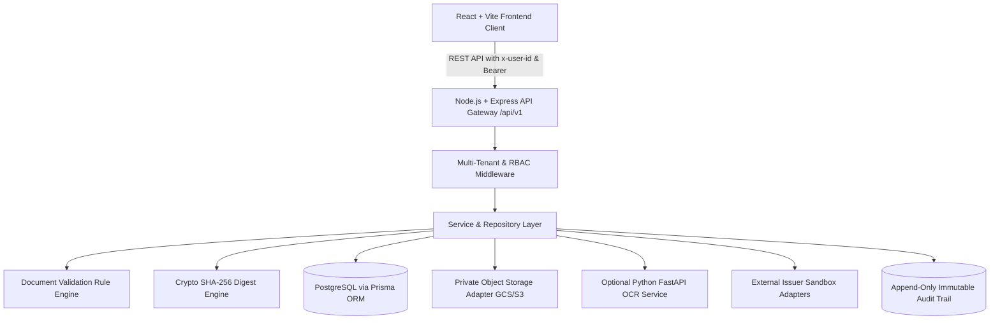

# System Architecture & Technical Design

## Overview
**EduVerify-AI** is architected as an institutional regulatory governance platform adhering to AICTE Approval Process Handbook (APH) guidelines. It features a strict multi-tenant boundary, server-authoritative role-based access control, cryptographic document verification, and an append-only audit trail.

## Core Subsystems
1. **Frontend Presentation Layer**: React 19 SPA running on Vite, styled with Tailwind CSS using the exact regulatory color palette (`#115E59`, `#0D9488`, `#F3F8F7`, `#193A39`).
2. **REST API Gateway**: Versioned under `/api/v1` with centralized error handling, sensitive header redaction, and strict input validation.
3. **Multi-Tenant Isolation**: College Management sessions are strictly locked to their single designated institution ID. Cross-tenant queries return HTTP 403 `TENANT_ACCESS_DENIED`.
4. **Validation Rules Engine**: Evaluates file integrity, expiry validity, institution name fuzzy match (Jaccard similarity), and cross-docket duplicate file anomaly.
5. **Verification Framework**: Pluggable G2G adapters for verifying certificate reference numbers against state electronic ledgers with anti-SSRF IP restrictions.
