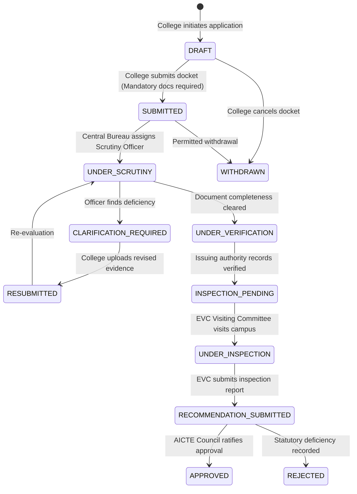

# Regulatory Approval Workflow Specification

## AICTE Approval State Machine Lifecycle

## Authorized Roles & Transitions
1. `DRAFT -> SUBMITTED`: Permitted only to `COLLEGE_MANAGEMENT` with valid mandatory certificates.
2. `SUBMITTED -> UNDER_SCRUTINY`: Permitted to `SCRUTINY_OFFICER` and `AICTE_ADMIN`.
3. `UNDER_SCRUTINY -> CLARIFICATION_REQUIRED`: Triggered when checklist item has `CLARIFICATION_REQUIRED`.
4. `UNDER_SCRUTINY -> UNDER_VERIFICATION`: Forwarded when all checklist items pass.
5. `RECOMMENDATION_SUBMITTED -> APPROVED / REJECTED`: Strictly restricted to `AICTE_ADMIN`.
